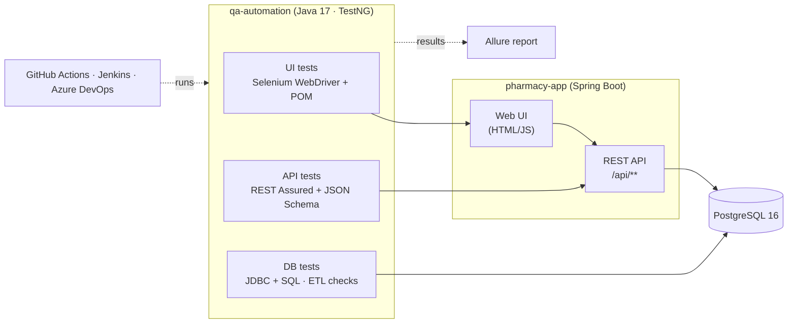

# RxCare Pharmacy — QA Automation Framework

[](https://github.com/OWNER/pharmacy-qa-automation/actions/workflows/ci.yml)

End-to-end quality engineering project for a **retail pharmacy management system**: a Java test automation framework covering **UI (Selenium WebDriver + TestNG + Page Object Model)**, **REST API (REST Assured)** and **database (SQL / JDBC, including ETL validation)**, wired into **GitHub Actions, Jenkins and Azure DevOps**, with the manual QA artefacts that go with it (test strategy, test cases, traceability, defect reporting, exploratory charters).

The repository includes its own system under test, **RxCare Pharmacy**: a Spring Boot + PostgreSQL app with patient management, prescription processing (intake → pharmacist verification → fill → pickup → refill), allergy screening, controlled-substance rules, inventory and a daily-sales ETL job. Everything runs locally with one `docker compose` command.

> Demo project. RxCare and all data in it are fictional. Not affiliated with, or derived from, any vendor's pharmacy software.

---

## Architecture



## How this maps to the role

| Responsibility | Where it lives |
|---|---|
| Requirement analysis & test planning | [`docs/test-strategy.md`](docs/test-strategy.md), [`docs/traceability-matrix.md`](docs/traceability-matrix.md) |
| Test case design (SpiraTeam/JIRA import-ready) | [`docs/test-cases.csv`](docs/test-cases.csv) — 56 automated + 3 manual cases, each linked to a story |
| Selenium WebDriver + TestNG + POM framework | [`qa-automation/src/main/java/com/rxcare/qa/pages`](qa-automation/src/main/java/com/rxcare/qa/pages), [`driver`](qa-automation/src/main/java/com/rxcare/qa/driver) |
| Data-driven testing | TestNG `@DataProvider` fed by CSV/JSON in [`src/test/resources/testdata`](qa-automation/src/test/resources/testdata) |
| REST API testing (REST Assured, Postman) | [`tests/api`](qa-automation/src/test/java/com/rxcare/qa/tests/api), [`postman/`](postman) |
| SQL backend validation, data integrity, ETL testing | [`tests/db`](qa-automation/src/test/java/com/rxcare/qa/tests/db), [`PharmacyQueries.java`](qa-automation/src/main/java/com/rxcare/qa/db/PharmacyQueries.java) |
| Pharmacy workflows (Rx processing, patients, dispensing, inventory, POS) | [`PrescriptionWorkflowUiTest`](qa-automation/src/test/java/com/rxcare/qa/tests/ui/PrescriptionWorkflowUiTest.java), [`PrescriptionApiTest`](qa-automation/src/test/java/com/rxcare/qa/tests/api/PrescriptionApiTest.java) |
| CI/CD: Jenkins, Azure DevOps, GitHub | [`Jenkinsfile`](Jenkinsfile), [`azure-pipelines.yml`](azure-pipelines.yml), [`.github/workflows/ci.yml`](.github/workflows/ci.yml) |
| Regression optimisation | Parallel TestNG execution (ThreadLocal drivers), API-based test setup, suite split into parallel CI jobs, smoke gate |
| Defect management & RCA | [`docs/defect-report-example.md`](docs/defect-report-example.md), [issue template](.github/ISSUE_TEMPLATE/defect.md) |
| Exploratory testing | [`docs/exploratory-charters.md`](docs/exploratory-charters.md) |
| Smoke / sanity / regression / release validation | `smoke`, `api`, `db`, `ui`, `regression` suites in [`suites/`](qa-automation/src/test/resources/suites) |

## Tech stack

Java 17 · Maven · Selenium 4 · TestNG 7 · REST Assured 5 · JSON Schema Validator · PostgreSQL 16 · JDBC · Allure 2 · SLF4J · Spring Boot 3.5 (SUT) · Docker Compose · Postman/Newman · GitHub Actions · Jenkins · Azure DevOps

## Project structure

```
pharmacy-qa-automation/
├── pharmacy-app/                     System under test (Spring Boot + PostgreSQL)
│   └── src/main/resources/
│       ├── schema.sql, data.sql      Schema with constraints + deterministic seed data
│       └── static/                   Web UI (login + pharmacy workstation), data-testid hooks
├── qa-automation/                    Test framework
│   ├── src/main/java/com/rxcare/qa/
│   │   ├── config/                   Layered config (properties → env vars → -D flags)
│   │   ├── driver/                   DriverFactory (chrome/firefox/edge, local or Grid), ThreadLocal manager
│   │   ├── pages/ (+ components/)    Page Object Model
│   │   ├── api/ (+ models/)          REST Assured clients, request/response models, workflow helpers
│   │   ├── db/                       JDBC client + catalogue of validation SQL
│   │   ├── data/                     Test data factory, CSV/JSON readers, seed references
│   │   └── listeners/                Health gate, logging, retry (UI only), failure screenshots
│   └── src/test/
│       ├── java/.../tests/{api,db,ui}  Test classes
│       └── resources/                TestNG suites, test data, JSON schemas, Allure config
├── postman/                          Postman collection + environment (run by Newman in CI)
├── docs/                             Test strategy, test cases, RTM, defect example, charters
├── .github/workflows/ci.yml          GitHub Actions
├── Jenkinsfile                       Jenkins declarative pipeline
├── azure-pipelines.yml               Azure DevOps pipeline
└── docker-compose.yml                PostgreSQL + app (+ Selenium Grid profile)
```

## Run locally

**Prerequisites:** JDK 17+, Maven 3.9+, Docker, Google Chrome.

```bash
# 1. Start PostgreSQL + the app (http://localhost:8080)
docker compose up -d --build

#    ...or run the app from source against the containerised database
docker compose up -d db
mvn -f pharmacy-app/pom.xml spring-boot:run

# 2. Run tests
mvn -f qa-automation/pom.xml test -Dsuite=smoke          # ~10 critical checks
mvn -f qa-automation/pom.xml test -Dsuite=api
mvn -f qa-automation/pom.xml test -Dsuite=db
mvn -f qa-automation/pom.xml test -Dsuite=ui -Dheadless=true
mvn -f qa-automation/pom.xml test                        # full regression

# 3. Open the Allure report
mvn -f qa-automation/pom.xml allure:serve
```

Sign in to the app with `rph.jones / Pharm@123` (pharmacist) or `tech.smith / Tech@123` (technician).

The app recreates its schema and seed data on every start, so restart it (`docker compose restart app`) to return to a clean baseline.

### Useful switches

| Flag | Values | Default |
|---|---|---|
| `-Dsuite` | `smoke`, `api`, `db`, `ui`, `regression` | `regression` |
| `-Denv` | `local`, `ci`, `docker` (see `src/main/resources/config/`) | `local` |
| `-Dbrowser` | `chrome`, `firefox`, `edge` | `chrome` |
| `-Dheadless` | `true` / `false` | per env |
| `-Dgrid.url` | Selenium Grid URL, e.g. `http://localhost:4444` | local browser |
| `-Dgroups` | TestNG groups, e.g. `smoke`, `e2e`, `etl` | all in suite |

Every config key can also come from an environment variable (`db.url` → `DB_URL`, `app.baseUrl` → `APP_BASE_URL`), which is how CI injects secrets.

### Run against Selenium Grid in Docker

```bash
docker compose --profile grid up -d --build
mvn -f qa-automation/pom.xml test -Dsuite=ui -Denv=docker
# watch the browser at http://localhost:7900 (password: secret)
```

## CI/CD

| Pipeline | Trigger | What it does |
|---|---|---|
| **GitHub Actions** (`ci.yml`) | push, PR, weekday nightly, manual (pick suite + browser) | Build & unit-test app → API, DB and UI suites as **parallel jobs**, each with its own PostgreSQL service → Newman run of the Postman collection → merged **Allure report** artifact (optional publish to GitHub Pages: set repo variable `PUBLISH_ALLURE=true`) |
| **Jenkins** (`Jenkinsfile`) | SCM, weekday nightly, manual with `SUITE` parameter | Build → `docker compose` environment incl. Selenium Grid → smoke gate → regression → JUnit + Allure publishing, failure screenshots archived |
| **Azure DevOps** (`azure-pipelines.yml`) | push, PR, weekday nightly | Build stage → test stage with an API / DB / UI matrix on PostgreSQL service containers → results in the *Tests* tab, Allure results as artifacts |

## Framework design highlights

- **Page Object Model with components** — pages expose business actions (`verify(rx)`, `completeSale("CARD")`), never raw locators. All locators use `data-testid`.
- **No sleeps, no implicit waits** — explicit waits plus a `data-state="loading|ready"` contract on tables, and helpers that clear stale state before each action.
- **Parallel-safe** — `ThreadLocal` WebDriver, unique generated test data, reserved NDCs per test class for exact inventory deltas.
- **Arrange via API, assert via UI + DB** — `PrescriptionWorkflow` puts a prescription into any state in milliseconds so UI tests only spend browser time on the behaviour under test.
- **Database as an oracle** — integrity rules written as SQL that returns *violating rows*; a failure message lists the exact offending records.
- **ETL validation** — source-vs-target reconciliation, duplicate-key and idempotency checks for the daily sales job.
- **Fail fast** — a suite listener waits for `/api/health` and stops with a clear message if the app is not up.
- **Flakiness control** — retry only for UI tests and only in CI; API/DB failures are never retried.
- **Evidence** — Allure captures REST requests/responses, every SQL query with parameters, and screenshot + page source on UI failure.

## Test coverage

| Suite | Classes | Test methods | Focus |
|---|---|---|---|
| API | `AuthApiTest`, `PatientApiTest`, `PrescriptionApiTest`, `InventoryApiTest`, `SystemApiTest` | 32 | Contracts, business rules, negative & boundary data |
| DB | `DataIntegrityTest`, `DatabaseConstraintTest`, `DailySalesEtlTest` | 7 (29 executions with data providers) | Integrity, constraints, ETL |
| UI | `LoginUiTest`, `PatientUiTest`, `PrescriptionWorkflowUiTest`, `InventoryUiTest` | 17 | Critical journeys, role-based UI, E2E |

## License

MIT — use it freely for learning and interviews.
